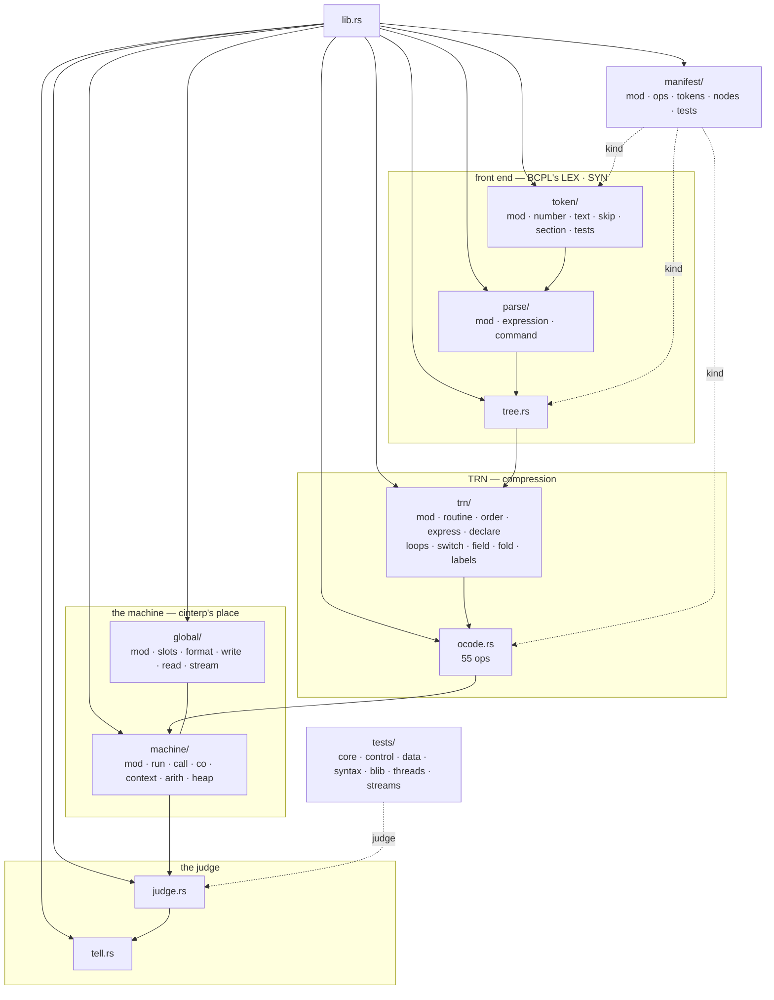
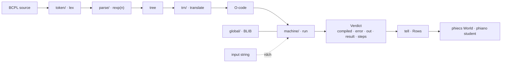
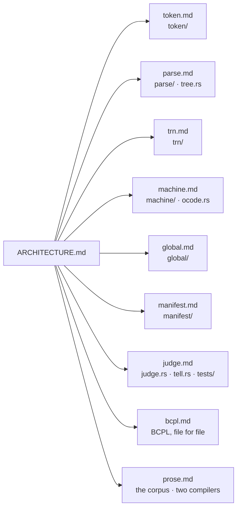

# phiclm — architecture

## The crate, folder by folder

## The pipeline

## The module diagrams

| diagram | file |
|---|---|
| the lexer | [docs/phiclm/token.md](../../docs/phiclm/token.md) |
| the parser and the tree | [docs/phiclm/parse.md](../../docs/phiclm/parse.md) |
| the translator | [docs/phiclm/trn.md](../../docs/phiclm/trn.md) |
| the machine and O-code | [docs/phiclm/machine.md](../../docs/phiclm/machine.md) |
| BLIB | [docs/phiclm/global.md](../../docs/phiclm/global.md) |
| the ladder | [docs/phiclm/manifest.md](../../docs/phiclm/manifest.md) |
| the judge | [docs/phiclm/judge.md](../../docs/phiclm/judge.md) |
| BCPL, file for file | [docs/phiclm/bcpl.md](../../docs/phiclm/bcpl.md) |
| prose and the two compilers | [docs/phiclm/prose.md](../../docs/phiclm/prose.md) |

## Status

2026-10-27 · 38 tests + 1 doc test · every .rs file ≤ 200 lines · what is left: [TODO.md](TODO.md).
