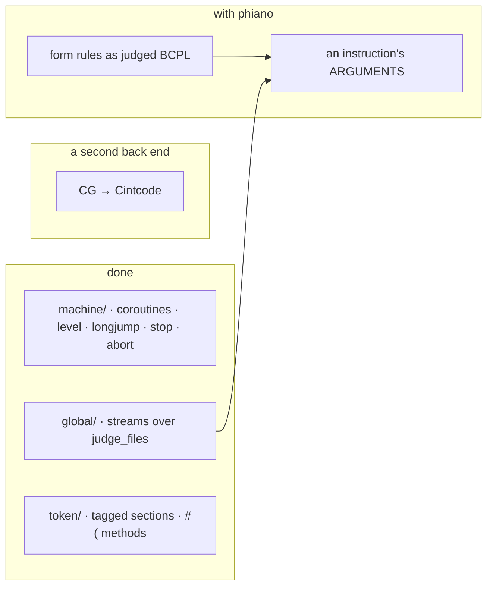

# phiclm — TODO

## machine/
- [x] Coroutines (`createco callco cowait resumeco deleteco`): a `Context` per coroutine, its stack in a `getvec` block, transfers in `co.rs`; a body that returns is fresh again, as BLIB's REPEAT loop.
- [x] `level()` / `longjump(lev, lab)`: frames popped to `lev`, the expression stack cut to its entry depth; `stop` and `abort`.
- [x] Floats in words · `getvec` heap · faults as verdicts · `Goto`.

## global/
- [x] Streams: `judge_files` hands named texts to `findinput`; `findoutput`'s text comes back in `Verdict::written`; `selectinput`/`selectoutput` park the live buffers, `endread`/`endwrite` close.
- [x] `writef` and the writers · `rdch unrdch readn` · `randno setseed` · `muldiv` · `packstring unpackstring` · `libhdr`.

## token/ · parse/
- [x] Tagged section brackets: `$)tag` closes every open section back to `$(tag` (`token/section.rs`); tested.
- [x] `E#(obj, args…)` is `((!obj)!E)(obj, args…)`; tested through an object's method table.
- [x] Floats and `#` operators · `::` · `[ ]` · nested comments · every escape · `$<tag` conditions.
- [x] BCPL's `rexp(n)` priorities · LET and assignment lists · `TEST … OR` · GOTO of an expression.

## trn/
- [x] SWITCHON · labels · STATIC · TABLE · SLCT/OF · block functions · one innermost-first scope.

## a second back end
- [ ] CG to Cintcode: not built on purpose — a second interpreter of the same programs. Only as interop with Richards' cintsys (packed bytes, BLIB's global numbers), if that is wanted.

## with phiano
- [ ] The guide's form rules (`-ing`, `-ed`, plurals) as BCPL over `s%i`, judged against the Key.
- [ ] An instruction's program carries its arguments, not only its template's shape (docs/201).

## lisp/
- [x] Moved from phiano (`sys::lisp`, `sys::set`'s algebra): the reader, the values, the machine made generic over a `Host`, the 39 core primitives, the relation algebra; phiano's personas and scopes are its host (docs/phiclm/lisp/plan.md, jobs.md).
